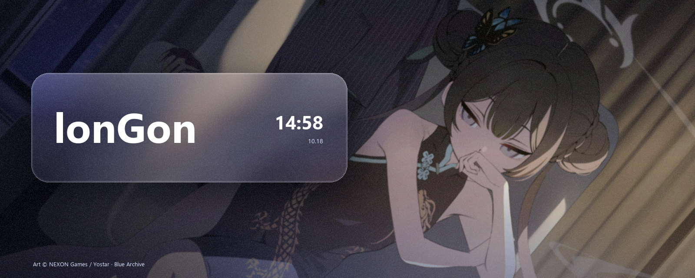

<!--
  lonGon 的主页
  横幅 assets/hero.png ｜ 头像 assets/kisaki/avatar.png ｜ 时钟 output/clock.svg
  时钟由 .github/workflows/clock.yml 每 5 分钟重画一次；吃豆人由 scripts/make_pacman.py 生成
  素材：Blue Archive © NEXON Games / Yostar
-->

  

 

  在学 Python 和前端，喜欢把想法写成能跑的东西。 
  Blue Archive 常驻，偶尔通宵。

  

  

  

  

   

  现在　学 Python、前端 
  常用　VS Code · Git 
  弱项　早起

  

  
  
  
  

   

  Art © NEXON Games / Yostar · Blue Archive

